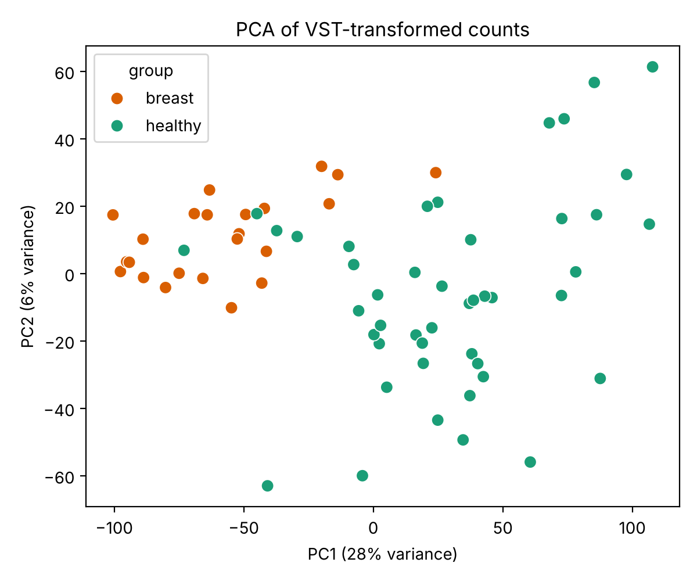
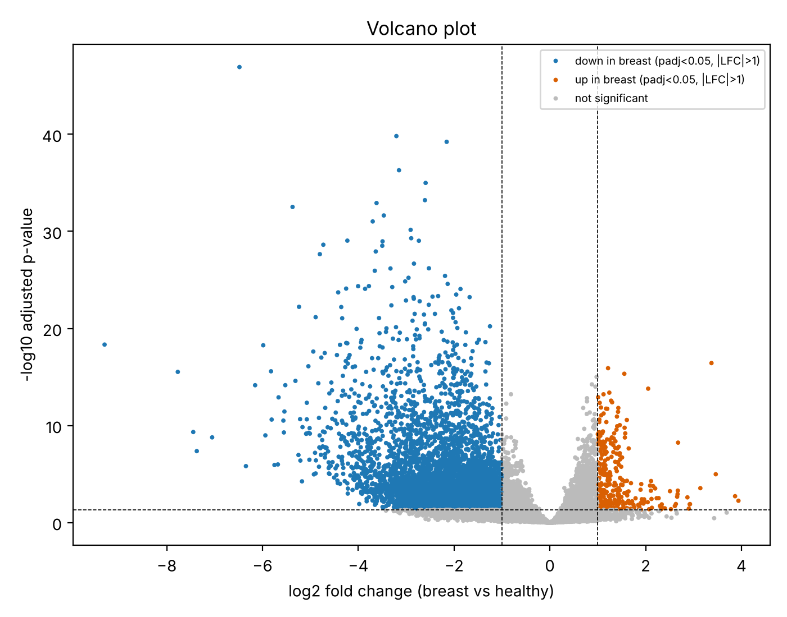
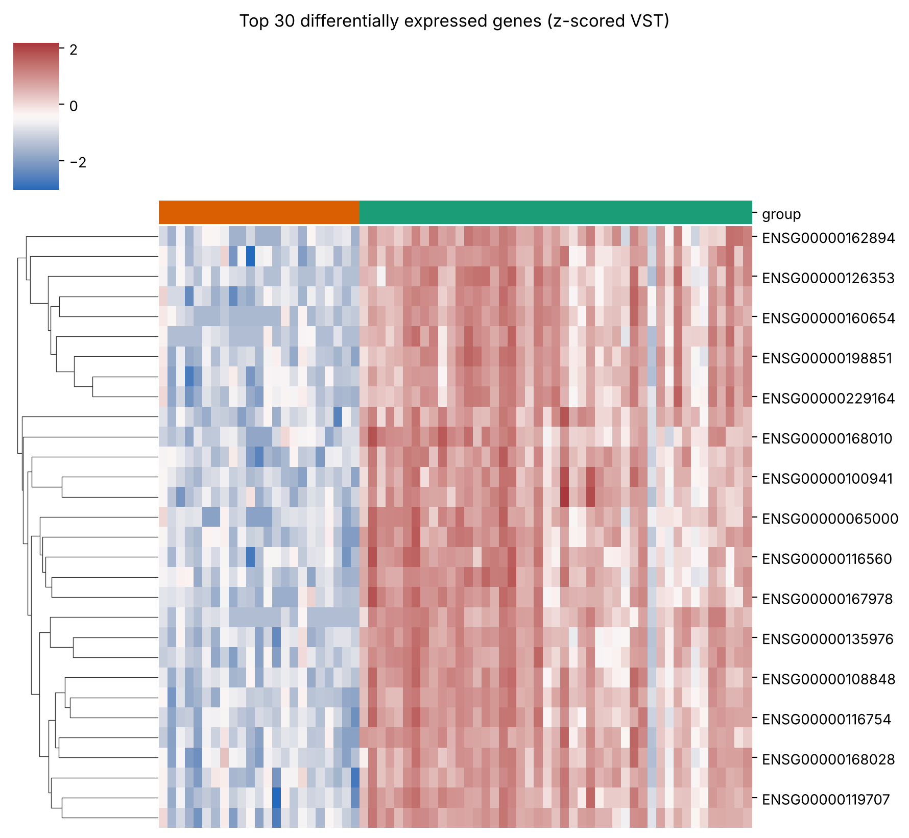
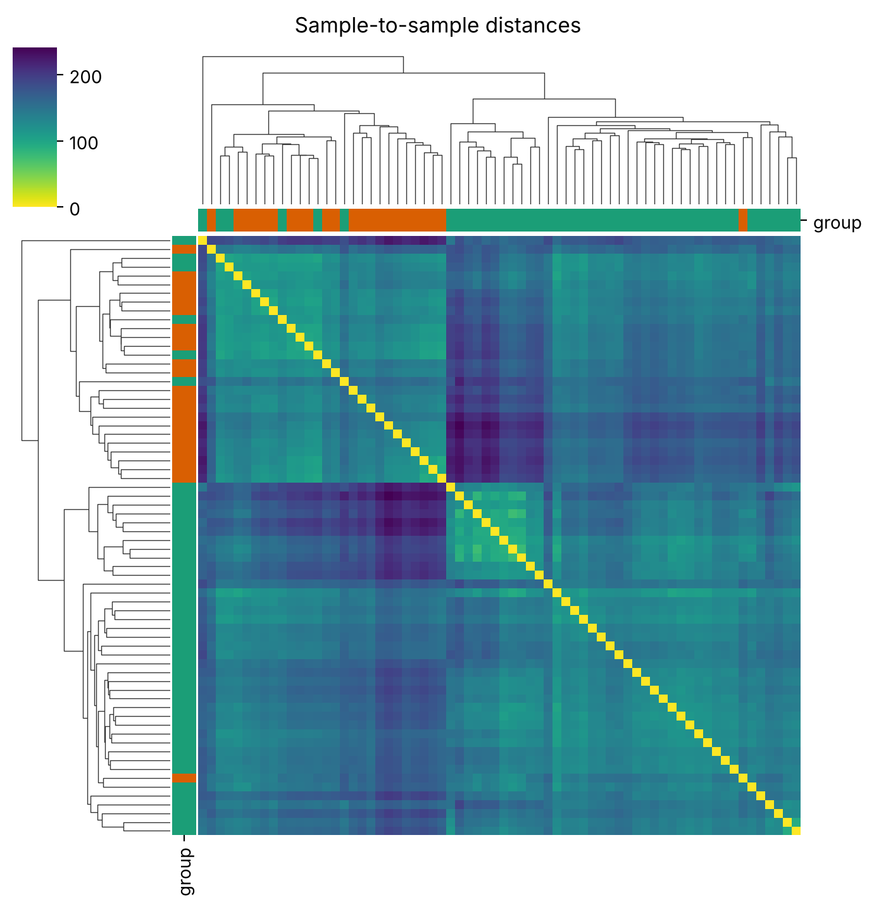

# RNA-seq Differential Expression: Breast Cancer vs Healthy Donor Platelets

Differential expression analysis of tumor-educated platelet (TEP) RNA-seq data comparing **breast cancer patients (n=23)** with **healthy donors (n=45)**.

**Dataset:** GEO [GSE68086](https://www.ncbi.nlm.nih.gov/geo/query/acc.cgi?acc=GSE68086) (Best et al., *Cancer Cell* 2015). TEP data matrix of raw counts, 57,736 genes x 285 samples; only the Breast and HD samples were used.

## Workflow
1. Load the count matrix and select breast cancer and healthy donor (HD) samples (`01_load_data.R`).
2. Filter low-count genes (total count >= 10): 57,736 -> 14,934 genes.
3. Build a DESeq2 object (`design = ~ group`), apply variance-stabilizing transformation (VST), and run PCA (`01_load_data.R`).
4. Differential expression with the DESeq2 model, healthy as the reference, run with **PyDESeq2** (the Python implementation of DESeq2) in `rnaseq_analysis.py`. This script also makes the plots below.

## Results
- **6,503** genes significant at adjusted p < 0.05: **1,127 higher** and **5,376 lower** in breast cancer samples vs healthy donors.
- PCA shows the breast cancer samples separating from healthy donors along PC1 (28% of variance), with some overlap.

### PCA


### Volcano plot


### Top 30 genes


### Sample distances


Tables: `deseq2_all_genes.csv` (all tested genes) and `significant_genes_padj_0.05.csv`.

## Tools
R (DESeq2: data loading, filtering, VST, PCA); Python (pandas, NumPy, PyDESeq2, seaborn, matplotlib, SciPy).

## Run it
```
pip install pandas numpy matplotlib seaborn scipy pydeseq2
python rnaseq_analysis.py GSE68086_TEP_data_matrix.txt
```
(The data file is not included; download it from the GEO page above.)

## Limitations / next steps
- Gene IDs are Ensembl; mapping to gene symbols is still to be done.
- Functional enrichment (GO / pathway analysis) of the significant genes is planned.
- The healthy and breast groups were not adjusted for batch or other covariates.
